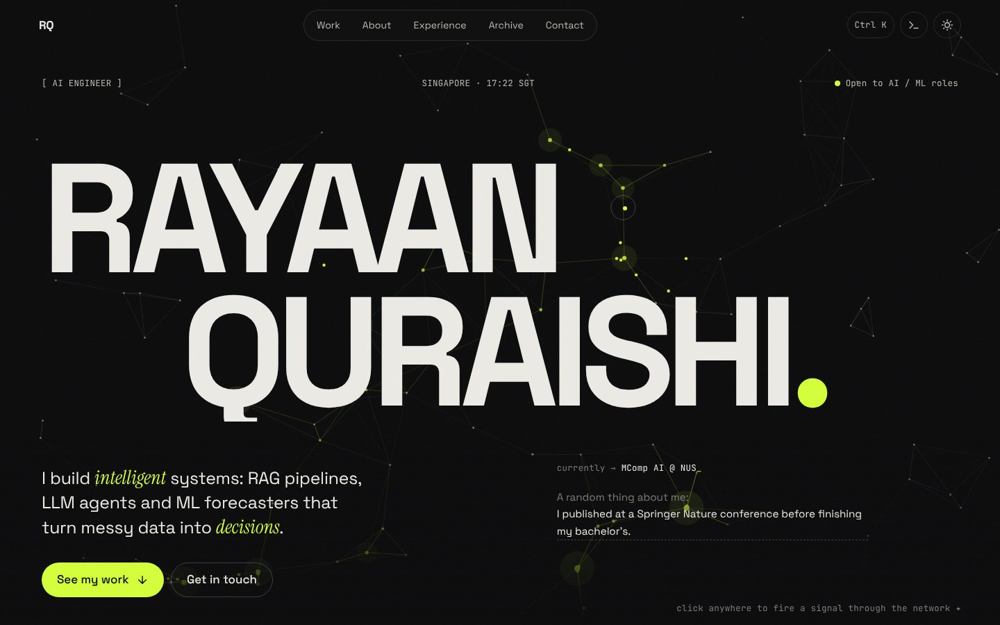

<div align="center">

# Rayaan Quraishi — Portfolio

**AI engineer · MComp (AI) @ NUS · building RAG pipelines, LLM agents and ML forecasters**

[**→ rayaanq.github.io/Portfolio**](https://rayaanq.github.io/Portfolio/)

[](https://github.com/RayaanQ/Portfolio/actions/workflows/deploy.yml)


-d4ff3a?labelColor=0b0b0c)



</div>

## What's inside

| | |
|---|---|
| 🧠 **Living neural network** | The hero is an interactive canvas network. Move the cursor to excite neurons, or click to fire a signal that propagates node to node. |
| 📊 **A live visual for every project** | Each featured project has its own generative animation: crisis-forecast bars, a page being scanned into a RAG summary, a compliance radar sweep, code being optimised for carbon, a Hindi pronunciation trainer. |
| 📖 **Case-study drawers** | Problem → Approach → Outcome for every project, with deep links (`#case-juristrack`). |
| ⌨️ **Command palette** | <kbd>⌘K</kbd> / <kbd>Ctrl K</kbd> or <kbd>/</kbd> to jump anywhere, open a case study, copy my email or switch theme. |
| 💻 **Terminal** | Press <kbd>`</kbd>. Try `help`, `projects`, `open 1`, `neofetch`, `sudo hire-me`. |
| 🗂 **Self-updating archive** | Every public repo, with languages and stars synced from the GitHub API on each deploy and every Monday. |
| 🌗 **Light and dark** | Follows the system setting by default. <kbd>T</kbd> toggles it. |
| 🥚 **Easter eggs** | Konami code, a random fact about me, an expanding logo, and a note in the console. |

## Built to be fast and accessible

- **No framework, no build step, no dependencies.** Three hand-written files: `index.html`, `style.css`, `main.js`. About 30 KB gzipped, plus fonts.
- **Animations only run when visible.** All canvases share one `requestAnimationFrame` loop and pause off-screen or in background tabs. Pixel density is capped at 2×.
- **`prefers-reduced-motion` is respected.** Canvases render one still frame, and the boot screen, cursor, grain and reveals are turned off.
- **All content is real HTML**, so it reads well without JavaScript, works with screen readers, and is indexable by search engines (JSON-LD `Person` schema, Open Graph image, sitemap).
- Semantic landmarks, a skip link, native `<dialog>` focus handling, visible focus rings, and keyboard access everywhere.

## Run it locally

```bash
git clone https://github.com/RayaanQ/Portfolio.git
cd Portfolio
python3 -m http.server 8000   # or: npx serve
# open http://localhost:8000
```

## Deploy (free, automatic)

Hosting is **GitHub Pages**, deployed by [`.github/workflows/deploy.yml`](.github/workflows/deploy.yml).

1. Go to **Settings → Pages → Build and deployment → Source** and choose **GitHub Actions**. You only do this once.
2. Push to `main`. The workflow syncs repo metadata, assembles the site and publishes it to `https://rayaanq.github.io/Portfolio/`.
3. It also re-runs every Monday, so star counts and languages stay current.

> **Want the shorter URL `https://rayaanq.github.io/`?** Rename this repo to `RayaanQ.github.io` and update the `canonical`, `og:url` and `og:image` tags in `index.html`, plus `robots.txt` and `sitemap.xml`. All asset paths are relative, so nothing else changes.
>
> **Custom domain later?** Add it under Settings → Pages and update the same tags. GitHub provides free HTTPS.

## Editing content

Everything is in `index.html`, one block per section.

| To change… | Edit |
|---|---|
| Hero text, rotating roles, random facts | `index.html` hero section; `roles()` and `FACTS` in `assets/js/main.js` |
| Featured projects and case studies | `<article class="project">` blocks; the case study is the `<template data-case>` inside each one |
| Archive table | `<tr data-repo="Exact-Repo-Name" data-tags="ai fullstack cs">` rows |
| Experience, education, honours | `#experience` section |
| Colours and fonts | CSS variables at the top of `assets/css/style.css` |
| Résumé button | Add `assets/Rayaan_Quraishi_Resume.pdf`. The button appears automatically when the file exists. |

See [`docs/PROJECT_PLAYBOOK.md`](docs/PROJECT_PLAYBOOK.md) for a repo-by-repo checklist to make every project portfolio-ready.

## Structure

```
.
├── index.html                 # all content
├── 404.html                   # custom not-found page
├── assets/
│   ├── css/style.css          # design tokens, layout, components
│   ├── js/main.js             # neural field, project visuals, palette, terminal
│   └── img/                   # favicon, social preview
├── data/github.json           # generated on deploy by scripts/fetch-github.mjs
├── scripts/fetch-github.mjs   # GitHub API → archive metadata (zero deps)
├── docs/PROJECT_PLAYBOOK.md   # how to level up each repo
└── .github/workflows/deploy.yml
```

## License

Code: [MIT](LICENSE). Feel free to learn from it or fork the structure.
Written content, project descriptions and personal details © Rayaan Quraishi.
